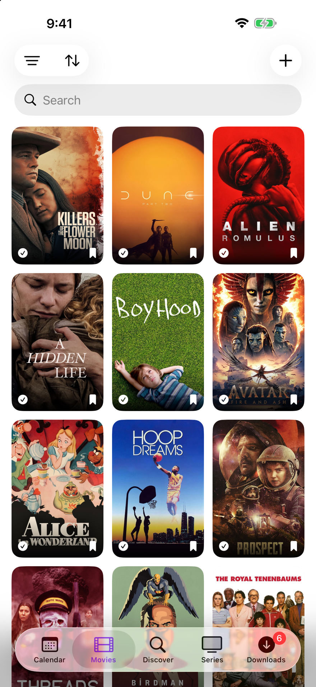
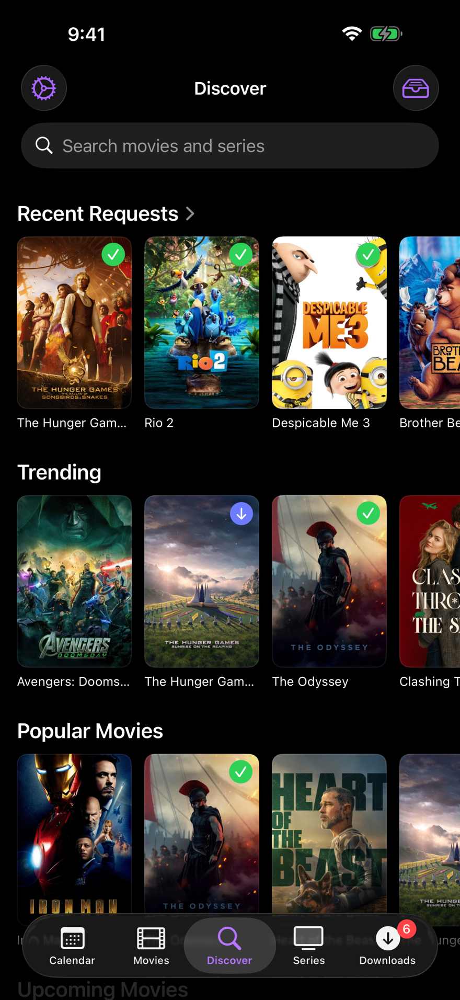
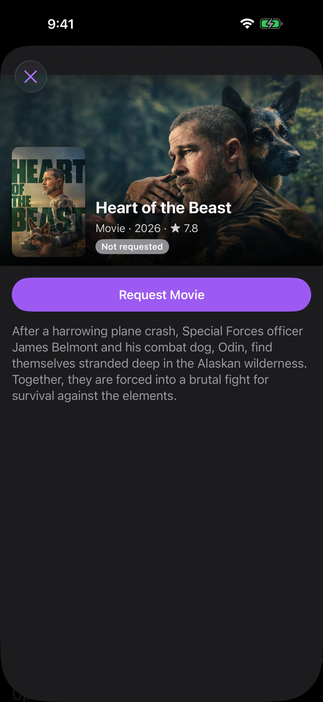
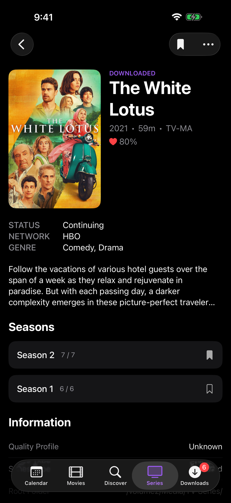
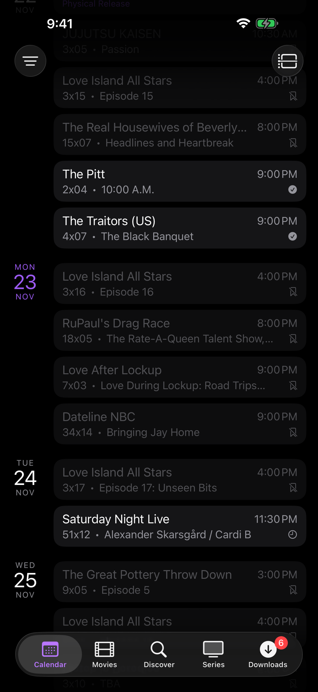
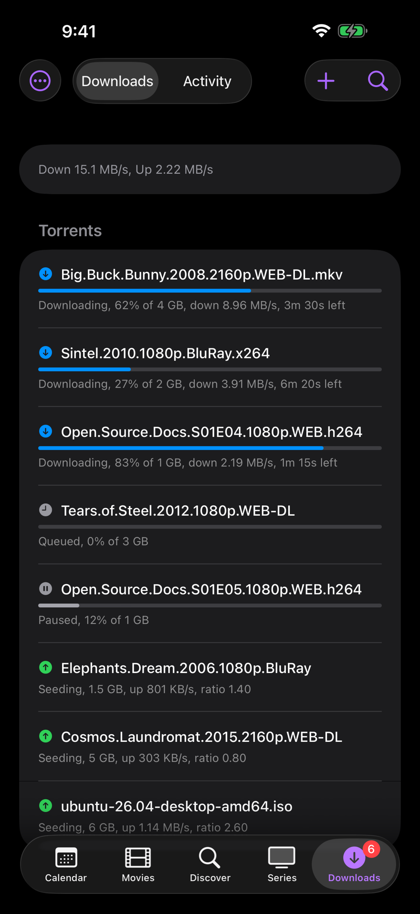

# Ruddarr

Ruddarr is a beautifully designed, open source, companion app for Radarr and Sonarr instances written in SwiftUI.

This fork adds download clients, Prowlarr, Seerr and VoiceOver support. It's built for sideloading and isn't the App Store version.

- [Original Ruddarr on the App Store](https://apps.apple.com/app/ruddarr/id6476240130) (without this fork's additions)
- [Join the Discord](https://discord.gg/UksvtDQUBA)

## Features

- Manage movies and TV series
- Browse upcoming releases in the calendar
- Discover and request movies and series with Seerr: poster rows for trending, popular and upcoming titles, search, and approving or declining requests
- Control download clients: qBittorrent, Deluge and SABnzbd (pause, resume, remove, add links and set speed limits)
- Search indexers with Prowlarr
- View activity queue tasks and history events
- Switch between multiple instances
- Import every server at once from a settings file or the clipboard
- Customize the app color scheme and appearance
- Automate actions using Siri Shortcuts
- Connect to reverse proxies using custom HTTP headers
- Use Spotlight search to quickly jump to media
- Works with VoiceOver
- Fully localized, ready to be translated

The tab bar has **Calendar**, **Movies**, **Discover**, **Series** and **Downloads**. The Downloads tab switches between the download client and the Radarr/Sonarr **Activity** queue, with **History** inside Activity. **Settings** opens from the gear button on Discover.

## Screenshots
<p>
  <a href=".github/screenshots/movies.png"></a>
  <a href=".github/screenshots/discover.png"></a>
  <a href=".github/screenshots/discover-details.png"></a>
</p>
<p>
  <a href=".github/screenshots/series-details.png"></a>
  <a href=".github/screenshots/calendar.png"></a>
  <a href=".github/screenshots/downloads.png"></a>
</p>

## Importing Settings

Radarr and Sonarr instances, download clients, Prowlarr and Seerr can be set up in one go from a JSON file. Share the file to Ruddarr from the Files app, or use **Downloads → Import Settings** (from a file or the clipboard). Entries that match an existing instance or client (same type and URL) are updated in place.

```json
{
  "instances": [
    { "type": "sonarr", "label": "Sonarr", "url": "http://10.0.0.5:8989",
      "alternateURL": "https://sonarr.example.com", "apiKey": "...", "headers": [] }
  ],
  "downloadClients": [
    { "kind": "qbittorrent", "label": "qBittorrent", "url": "http://10.0.0.5:8080",
      "username": "...", "password": "..." },
    { "kind": "deluge", "label": "Deluge", "url": "http://10.0.0.5:8112", "password": "..." },
    { "kind": "sabnzbd", "label": "SABnzbd", "url": "http://10.0.0.5:8080", "apiKey": "..." }
  ],
  "prowlarr": { "url": "http://10.0.0.5:9696", "apiKey": "..." },
  "seerr": { "url": "http://10.0.0.5:5055", "apiKey": "..." }
}
```

The file holds API keys and passwords, so don't share it.

## Localization

Help [translate Ruddarr](https://crowdin.com/project/ruddarr) into any language. Check the `#translators` channel [on Discord](https://discord.gg/UksvtDQUBA). Unfortunately, [some messages](https://github.com/ruddarr/app/issues/433) cannot be translated by Ruddarr.

## Notifications and iCloud

Sideloaded builds of this fork have no push notification, iCloud or App Group capabilities, so push notifications and syncing instances between devices are off. CloudKit is mocked in `Ruddarr::init()`. The notification service is [open source](https://github.com/ruddarr/apns-worker) if you want to set up your own.

## URL Schemes

Ruddarr supports the `ruddarr://` URL Scheme to open specific tabs, items or perform actions. All supported schemes are listed in [`QuickActions.swift`](Ruddarr/Dependencies/QuickActions.swift). The old `ruddarr://activity` link opens Activity inside the Downloads tab.

## Development

To build the app locally Xcode must be signed into an Apple Account:

```
Xcode → Settings → Accounts
```

Next, select the Apple Account's team for the `Ruddarr` and `NotificationService` targets, and change their bundle identifiers to ones your team owns (for example `com.yourname.ruddarr` and `com.yourname.ruddarr.notifications`):

```
Ruddarr → Signing & Capabilities → Targets → {target} → Signing → Team
```

The capabilities are already removed and CloudKit is already mocked, so a free or paid Apple Account works without extra provisioning.

On the first build, Xcode asks to trust the SwiftLint build plugin. Choose **Trust & Enable**.

> [!NOTE]
> Settings are stored in the `group.com.ruddarr` defaults suite (`Ruddarr.group` in `Ruddarr.swift`). Without the App Group capability, the suite lives in the app's own container, which is fine for sideloaded builds.

That's it. Select a run destination and build it.

### Signed IPA from GitHub Actions

The `Personal IPA` workflow (`.github/workflows/personal-ipa.yml`) builds a signed Ad Hoc IPA on pushes to `personal`, or on demand. It needs these repository secrets: `APPLE_TEAM_ID`, `APP_BUNDLE_ID`, `IOS_CERTIFICATE_P12`, `IOS_CERTIFICATE_PASSWORD` and `IOS_PROVISION_PROFILE`.

### Sentry Symbols

Create a `.sentryclirc` file:

```yml
[auth]
token=sntrys_eyJp...
```

### Reset Xcode

```bash
sudo xcode-select -s /Applications/Xcode.app
xcrun simctl --set previews delete all
```
